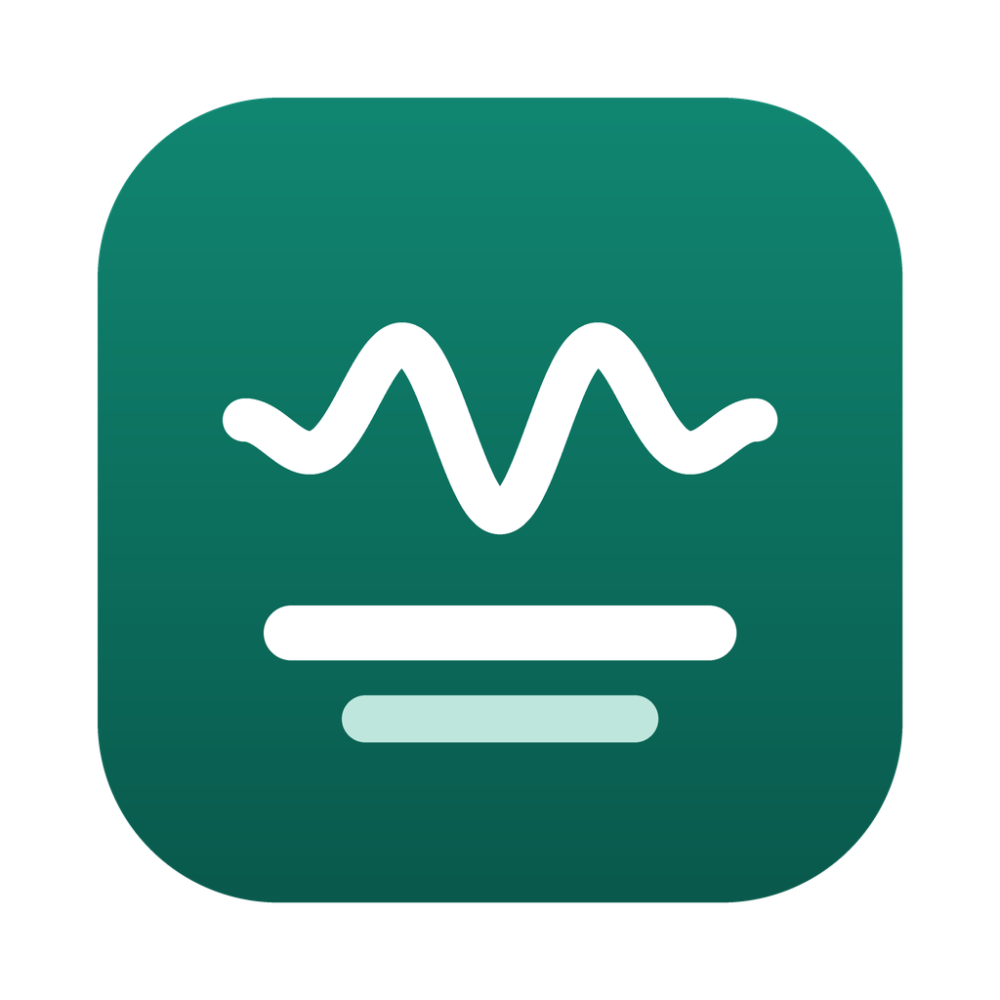

<div align="center">



# 声渡 · SubCast

**听懂海外播客和 YouTube。**

订阅 YouTube 频道、Apple Podcasts、小宇宙和任意 RSS；官方字幕优先，没有就用本机模型识别；AI 译成中文对照着听，还能直接问节目。

macOS · Windows · Linux

</div>

## 功能

| | |
|---|---|
| **订阅** | 粘贴 YouTube 频道（@名字 / 频道 / 播放列表）、Apple Podcasts、小宇宙节目或任意 RSS；也可以搜索 Apple Podcasts 目录。单个 YouTube 视频或小宇宙单集可直接打开。 |
| **听与看** | 播客音频后台播放（浏览其他页面不中断），YouTube 在 App 内看视频并叠加中文字幕。记住进度，倍速，空格暂停，←/→ 跳 5 秒。 |
| **字幕** | YouTube 人工字幕 › YouTube 自动字幕 › RSS `<podcast:transcript>` › 本机识别：默认 **Qwen3-ASR 0.6B**（经 CrispASR，中英文都准、自带标点），也可选 Whisper；Apple 芯片用 Metal 加速，音频不出本机。 |
| **双语** | 用你自己的模型把字幕译成中文，双语 / 中文 / 原文三种显示；当前句高亮并跟随滚动，点句子跳转；可搜索文稿。 |
| **AI 问答** | 基于整期文字稿回答，引用带 `[mm:ss]` 时间戳，点击跳转到原话。 |
| **导读** | 一键生成中文导读：一句话总结、核心观点、章节、值得记住的原话。 |

## 模型服务

自带 Key，存于系统钥匙串（macOS Keychain / Windows Credential Manager / Linux Secret Service）。预置：DeepSeek、硅基流动、Kimi、Claude（Anthropic）、OpenAI、OpenRouter、Ollama（本机），以及任何 OpenAI 兼容服务。问答和翻译可分别选择不同服务。

## 开发

需要 Node.js 22+、Rust（stable）、CMake；Windows 另需 LLVM，Linux 需 `libwebkit2gtk-4.1-dev libdbus-1-dev clang cmake`。

```sh
npm install
npm run tauri dev      # 开发
npm run tauri build    # 打包当前平台
cd src-tauri && cargo test                       # 单元测试
cd src-tauri && cargo test -- --ignored --nocapture   # 访问真实服务的联网测试
```

三平台安装包由 `.github/workflows/build.yml` 在推送 `v*` 标签时构建。

## 架构

Tauri 2（Rust）+ React/TypeScript。所有网络请求在 Rust 侧完成（绕开 CORS、统一走代理）；数据存 SQLite；本机识别在子进程中运行 whisper.cpp（崩溃不影响主程序）。详见 [docs/ARCHITECTURE.md](docs/ARCHITECTURE.md) 与 [docs/PRD.md](docs/PRD.md)。

本机识别使用 [CrispASR](https://github.com/CrispStrobe/CrispASR)（MIT）运行 Qwen3-ASR，以及 [whisper.cpp](https://github.com/ggerganov/whisper.cpp)（MIT）。部分逻辑（YouTube InnerTube 字幕获取、字幕翻译提示词、Whisper 幻觉过滤）移植自 [乔木剪藏 qiaomu-clipper](https://github.com/joeseesun/qiaomu-clipper)（MIT）。

## License

MIT
